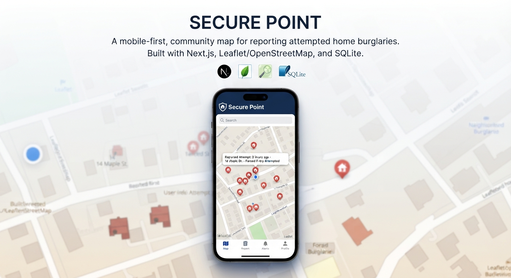

# Secure Point



A mobile-first, community map for reporting attempted home burglaries. Built with Next.js, Leaflet/OpenStreetMap, and SQLite.

Planned domain: [thievesmap.cloud](https://thievesmap.cloud)

## Why this project exists

Thieves Map helps neighbors share timely information about attempted theft and incidents of crime or neighborhood disorder. A person can add a report without creating an account; others can explore the map, see when and where reports were submitted, and choose to receive notifications about recent activity near a location they select. Older reports remain available in the map's history, making it easier to look back at what the community has reported over time.

The goal is to make local information easier to share and give residents a starting point for conversations with their neighbors, local organizations, or public authorities. It is a free, open-source project: communities can inspect the code, suggest improvements, and help shape how the service evolves.

### Support the project

Punto Sicuro is free and open source. Donations help cover the costs of hosting and maintaining its infrastructure.

[](https://github.com/sponsors/marcodefelice)

### Using the map responsibly

Reports reflect what users submit; they are not independently verified and do not establish that a crime occurred. The map is incomplete: an area with more reports is not necessarily less safe, and an area with no reports is not necessarily free of incidents. Reporting habits and access to the service vary, so the map should not be treated as official crime statistics or used to make judgments about people or neighborhoods.

Please report in good faith and describe events rather than identifying or accusing individuals. Notes and locations are public, so do not include names, identifying details, or other personal information. No account is required to submit a report, but the service retains a salted hash of the submitter's IP address to limit abuse; push subscribers also store a chosen location and subscription details. A public service needs a clear way to challenge or remove reports and active moderation.

Thieves Map does not contact emergency services and is not a replacement for an official report. In an emergency, contact the appropriate local emergency services directly; report suspected crimes to the competent authorities when appropriate.

### Run with Docker

```sh
docker compose up --build -d
```

Open <http://localhost:3000>. The database is stored in the Docker volume `reports_data`. For local development, run `npm ci && npm run dev`; the database will be created in `data`.

### Optional: Turso database

By default the app uses local SQLite. To use a remote **libSQL** database on Turso, set both `TURSO_DATABASE_URL` and `TURSO_AUTH_TOKEN` in `.env.local` for local Next.js, in `.env` for Docker Compose, or in the Vercel project environment settings. Vercel requires these variables: its local filesystem is not persistent. Create a libSQL database using the [Turso integration for Vercel](https://vercel.com/marketplace/tursocloud/database) or the Turso CLI, then obtain its URL and token. Treat the token as a secret.

```env
TURSO_DATABASE_URL=libsql://your-database.turso.io
TURSO_AUTH_TOKEN=your-database-token
```

The app creates the required table and indexes if missing. It does **not** automatically copy or synchronize reports between local SQLite and Turso. If only one credential is present, the app fails rather than silently using another database. Removing both variables selects the local database again (outside Vercel); changes made to the two databases remain separate.

To move existing reports, stop writes, create a consistent SQLite backup including any pending WAL changes (for example, with SQLite's `.backup` command), then create a **new** Turso database using `turso db create NAME --from-file PATH_TO_BACKUP`. Verify its records before switching traffic. Keep the local backup for rollback; reports written to Turso after the switch will not appear locally unless explicitly migrated back. See [Turso's import documentation](https://docs.turso.tech/cli/db/create). The source can be in the `reports_data` Docker volume rather than the local `data` folder.

For a public deployment, create a `.env` file:

```env
PUBLIC_ORIGIN=https://thievesmap.cloud
IP_HASH_SALT=a-long-random-secret-string
TRUST_PROXY=1
GEOCODER_USER_AGENT=PuntoSicuro/1.0 (contact: admin@example.com)
TURNSTILE_SITE_KEY=your-turnstile-site-key
TURNSTILE_SECRET_KEY=your-turnstile-secret-key
```

Set `TRUST_PROXY=1` only behind a trusted reverse proxy that rewrites the `X-Forwarded-For` header. Use HTTPS because browser geolocation requires it, except on localhost. Address search uses Nominatim and the map uses OpenStreetMap; no API key is needed.

### Country restriction for reports

Reports are accepted only when the country of the selected coordinates matches the country of the visitor's IP connection. Vercel supplies `X-Vercel-IP-Country`. On other hosts, configure a trusted reverse proxy to remove any incoming `X-Country-Code` header and replace it with its own ISO 3166-1 alpha-2 IP geolocation result, then set `TRUST_COUNTRY_PROXY=1`. Never enable this when clients can reach the app directly or supply that header. Without a trusted country header, including local development, submissions are blocked. The proxy must provide this header for local testing too. This is separate from `TRUST_PROXY`.

IP geolocation is approximate and can be wrong, especially with VPNs, mobile networks and near borders; VPNs can also circumvent the restriction. Simplified country boundaries can fail to identify small islands or border locations. Unknown countries are rejected. This check does not verify a person's physical presence or the truth of a report.

### Anti-spam verification

Create a Cloudflare Turnstile widget and allow the hostnames where the app runs, such as `thievesmap.cloud` and `localhost` for local testing. Set its site key as `TURNSTILE_SITE_KEY` and its secret as `TURNSTILE_SECRET_KEY` in Vercel for the environments you deploy. The site key is public and is passed to the browser; never commit or expose the secret. Redeploy after setting the variables. Vercel report submissions fail closed if either key is missing; local development can run without the widget when both are unset. The API validates each token with Cloudflare before saving a report, while retaining the existing report rate limit.

### Moderator applications and private administration

Visitors can submit a moderation application from the public collaboration form. They choose either one Italian municipality or one Italian province, never the whole country; this scope is checked server-side when they list, publish, or archive reports. Applications stay `pending`; no moderation privilege is granted until an administrator approves them. Approval sends a one-use activation link that expires after 48 hours. Moderators use password-backed, HTTP-only sessions; suspending a moderator deletes their sessions and is also checked on every protected request. Pins added by moderators require a public HTTPS source and retain the moderator nickname plus an audit trail. Archived reports disappear from the public map but remain in the database and audit log.

The administrator workspace is deliberately not linked anywhere in the public UI: open `/admin/moderators` directly. It still requires `ADMIN_API_TOKEN`; the URL alone never grants access. This workspace is paginated, lists only the configured admin country, and can approve, suspend, archive, or retrieve a report address on demand. Set these deployment secrets (never commit them):

```env
ADMIN_API_TOKEN=a-long-random-admin-secret
ADMIN_COUNTRY=IT
SMTP_HOST=smtps.aruba.it
SMTP_PORT=465
SMTP_SECURE=true
SMTP_USER=moderatori@tuodominio.it
SMTP_PASSWORD=la-password-della-casella
SMTP_FROM=Punto Sicuro <moderatori@tuodominio.it>
```

`PUBLIC_ORIGIN` must already be the public HTTPS URL so activation emails have a safe destination. Approval is intentionally blocked if the SMTP configuration is missing or sending fails; this prevents activating an account without a secure delivery path. The defaults above use Aruba's encrypted SMTP endpoint; use the exact mailbox credentials supplied by Aruba and never commit the password.

### Installable app and push notifications

Thieves Map can be installed from supported browsers. On iPhone and iPad, use Share → Add to Home Screen and open the installed app before enabling notifications. HTTPS is required outside localhost. The app and maps still require an internet connection.

Push notifications are optional and require a persistent database and VAPID keys. Generate a key pair once with:

```sh
npx web-push generate-vapid-keys
```

Set these variables in Vercel or in the Docker Compose `.env` file, then rebuild and redeploy:

```env
VAPID_PUBLIC_KEY=your-public-key
VAPID_PRIVATE_KEY=your-private-key
VAPID_SUBJECT=mailto:admin@example.com
```

Keep the private key secret and retain the same key pair across deployments; changing it can invalidate existing subscriptions. Each subscriber chooses their current position and a radius. The app stores that position, subscription endpoint and encryption keys in the configured database until the user disables notifications or the push service reports an expired subscription. It sends notifications for newly published theft, crime, and legacy combined-category reports less than one hour old within the selected radius. Urban decay reports do not trigger immediate push notifications. Delivery is best effort and depends on the browser and push service; notification delivery is not guaranteed. Reports remain unverified.

### How it works and limitations

Current-location reports use the submission date and time. Manual reports allow an address, date, and time up to one year in the past. Reports may describe theft or attempted break-ins, crime or suspicious activity, or urban decay, with optional public notes. Theft and crime pins are red and pulsing for one hour, orange up to 24 hours, yellow up to 48 hours, and then gray. These reports are shown from 48 hours to 30 days old when history is enabled. Urban decay uses a purple marker and a surrounding 150-metre visual highlight, is visible by default for 30 days, and appears in history up to one year. A button hides or shows urban decay. Older reports remain in the database and total count but are not displayed on the map. The total follows the urban-decay filter and includes hidden history. Reports are public and unverified; avoid including personal information in notes.

Existing reports in the former combined crime and disorder category remain labeled as such because their correct category cannot be inferred. They use the theft/crime history and notification behavior; the urban-decay filter does not hide them.

By default, the map, total and recent reports are filtered to the country at the map's center; the selector also allows a worldwide view. The total includes reports hidden by the history setting. Countries are calculated from the public report coordinates using simplified Natural Earth boundaries, including for older records, without changing stored reports. Locations near borders, coastlines and small islands can be misidentified or not matched; unmatched reports remain available in the worldwide view. When the map center is outside a recognized country, select worldwide view or move the map to a country.

Existing databases are updated automatically with category and notes columns. Existing reports default to the theft category and empty notes; older versions of the app can continue reading and writing the same database. Back up the database before deployment.

To limit abuse, the application applies a limit of one report per 15 minutes per IP address and server-side validation. Multiple people can report the same event, including from the same network, subject to that shared IP limit. On Vercel the application uses the platform-provided client IP; on other hosts it uses forwarded IP addresses only when `TRUST_PROXY=1`. Without a trusted proxy, the limit is shared by all visitors. A public service also needs moderation and a way to challenge or remove reports.

### Community confirmations and approximate locations

Users may confirm or dispute another report once per network; counts are indicators and do not verify or remove the report. The author cannot confirm from the same network, and a per-network limit reduces abuse; shared IP addresses may prevent different people on one network from confirming independently, while IP changes can permit repeat confirmations. Confirmation hashes are retained in the database. Without a trusted proxy, visitors share a single identity.

New theft reports are rounded to a fixed grid before storage and returned at approximate coordinates. A circle of roughly 150 metres is displayed around their public point. New crime and urban decay reports instead store and display the precise location selected by the user; the urban decay circle is a visual highlight and does not indicate location uncertainty; urban decay popups may show a reverse-geocoded address. Choose a public location and avoid revealing private addresses or personal information. Opening an exact-location popup sends its coordinates to the configured reverse-geocoding provider.

Existing reports, including older urban decay reports, remain approximate on the public map and retain their existing stored coordinates; the original exact location cannot be recovered from already-rounded coordinates. Approximation is not a guarantee of anonymity: precise locations may still appear in old database rows, past exports, logs, notes, geocoding providers, or caches. Notes are public and are not automatically screened. Do not include names, exact addresses, number plates, or security details.

New crime and urban decay reports show the selected precise point; crime reports require the submitter to affirm that the point is public and does not identify individuals, residences or businesses. Theft and legacy reports remain approximate. An optional indirect/news label is self-declared. Confirmations and disputes are limited to one vote per network per report and do not remove reports. Network-based limits can affect multiple people sharing an IP and are not proof of identity.

### RSS news review queue

RSS articles are never published automatically. The fetcher filters RSS/Atom titles and descriptions, extracts suggested details with an LLM and geocodes the suggested location. Only results with a matching Italian municipality, province and location enter the `draft_rss` queue. Missing or ambiguous locations are skipped; publication time is never substituted for the event date. LLMs can make mistakes, and the feed title and excerpt are sent to the configured provider.

Moderators see drafts for their assigned province or municipality; the administrator sees all drafts in the configured admin country. Both can inspect the source and map point, correct the data, then confirm and publish or discard. The server checks access to both the draft and the selected point. Approval and rejection are audited and approval happens at most once. Published pins use the existing location precision and map age rules; approval does not send a push notification.

#### Vercel configuration

`vercel.json` registers the protected `/api/cron/rss` endpoint once a day at 08:00 UTC on the production deployment. This schedule works on the free Hobby plan, whose invocation can be delayed by up to an hour. Vercel only runs cron jobs on production. A more frequent schedule (for example `0 */2 * * *`) requires a plan that permits it, or a separately scheduled worker. Changes to schedules or environment variables require a new deployment.

In Vercel Project Settings → Environment Variables, set these for **Production** (never commit or share secrets):

```env
RSS_FEEDS=https://example.org/local/rss.xml,https://example.org/other/rss.xml
RSS_LLM_ENDPOINT=https://openrouter.ai/api/v1/chat/completions
RSS_LLM_MODEL=openrouter/free
RSS_LLM_API_KEY=your-openrouter-key
RSS_GEOCODER_URL=https://us1.locationiq.com/v1/search
RSS_GEOCODER_API_KEY=your-locationiq-token
GEOCODER_USER_AGENT=PuntoSicuro/1.0 (contact: admin@example.com)
CRON_SECRET=replace-with-a-long-random-secret
TURSO_DATABASE_URL=libsql://your-database.turso.io
TURSO_AUTH_TOKEN=your-database-token
```

Replace example feed URLs and contact information with real ones. Generate `CRON_SECRET` with `openssl rand -hex 32` and save the result securely; Vercel sends it to the endpoint automatically. Turso must be the **same database as the live app**. The cron fails closed if its secret or configuration is missing, or if the LLM endpoint is not OpenRouter with `openrouter/free` or a `:free` model. Never point the public scheduler at a paid model. Keep the API keys secret.

The shared database atomically reserves each AI request **before** it is sent, counting errors and timeouts. It permits at most 40 requests per rolling 24 hours and 15 per rolling minute, leaving a margin under OpenRouter's published free-tier limits. Attempts for one URL are separated by at least 24 hours and limited to two in 30 days; already imported sources are never retried. Concurrent jobs share a lock and budget. The fetcher makes at most one geocoder request per AI attempt, so this job performs at most 40 geocoder calls per rolling 24 hours and spaces them by at least 1.1 seconds. Quotas apply only to this job and this database: other apps, manually executed requests, separate databases or other projects sharing your provider accounts consume the same provider quotas and are not visible here. Check account limits and terms, and monitor provider usage. Free model availability and limits can change.

Each run stops starting work after roughly 30 seconds to fit the function's 60-second maximum. Consequently it may process fewer than 40 articles in a run, and it does not guarantee that every feed or article is processed before it expires. Feeds are fetched independently with bounded concurrency, and candidate articles are processed in alternating feed order, rotated daily. A failing feed or article does not stop processing other available feeds, but the function time limit can defer remaining work. Articles without a valid publication date or older than 30 days are skipped, and unresolved locations may need manual entry. Feed errors are logged; inspect Vercel's cron/function logs after deployment. The job makes no automatic push notifications or public map changes.

#### Other hosts

The same worker can be run from a checkout with Node.js 22+ and `npm ci`: `node --env-file=/path/to/rss-worker.env scripts/fetch-rss.mjs`. Configure the same variables as above and use the same persistent SQLite `DATA_DIR` or Turso credentials as the app. To schedule it, use your host's cron or a separate worker. The production Docker web image does not include the worker. The local worker accepts other OpenAI-compatible LLM endpoints, but still enforces the shared RSS budget; use a geocoder that permits scheduled batch queries. Public Nominatim is unsuitable for systematic nationwide ingestion.
